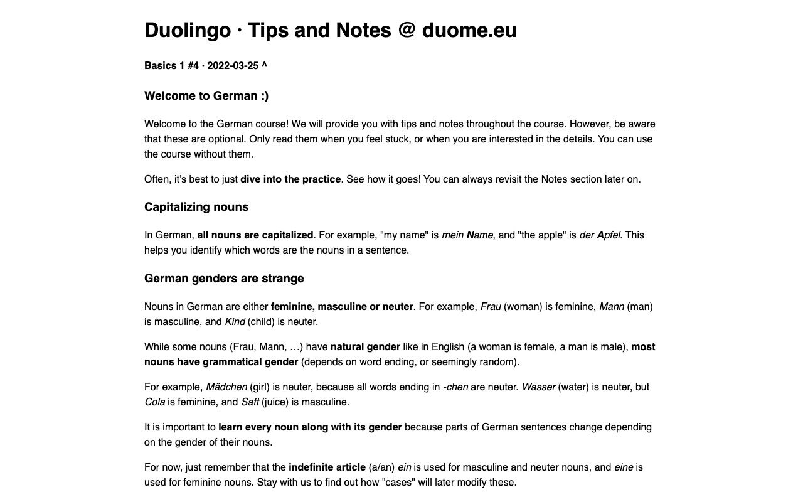

# Duolingo Tips and Notes: German

A personal copy of the official Duolingo German course "Tips and Notes", exported from [duome.eu](https://duome.eu). Covers grammar and vocabulary notes unit by unit, from Basics 1 onward.

*Screenshot: the first lines of `Duolingo Tips and Notes German.md` rendered to HTML.*

## Contents

- [`Duolingo Tips and Notes German.md`](<Duolingo Tips and Notes German.md>) - the notes in Markdown (about 8,500 lines).
- [`Duolingo Tips and Notes German.pdf`](<Duolingo Tips and Notes German.pdf>) - the same notes as a PDF.

## Source and license

The notes originate from the Duolingo course and were gathered via duome.eu. The repository is under the GPL-3.0 license in [`LICENSE`](LICENSE); that license covers this repository, not Duolingo's content.
